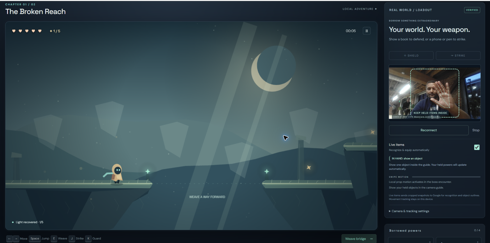
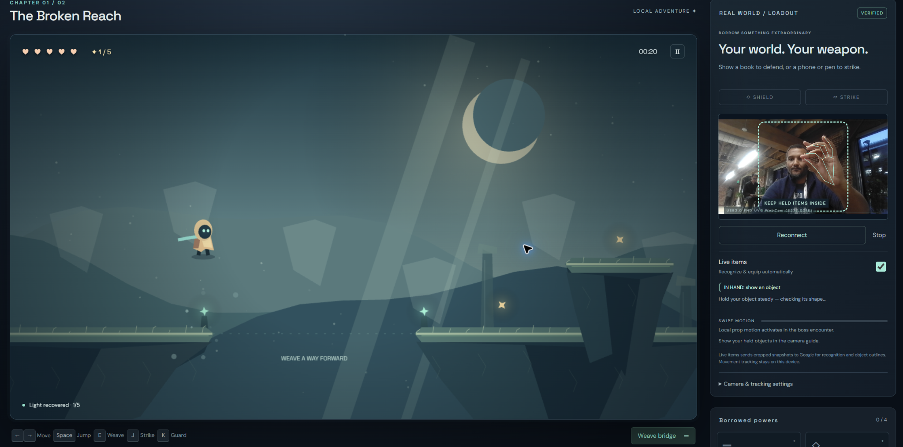
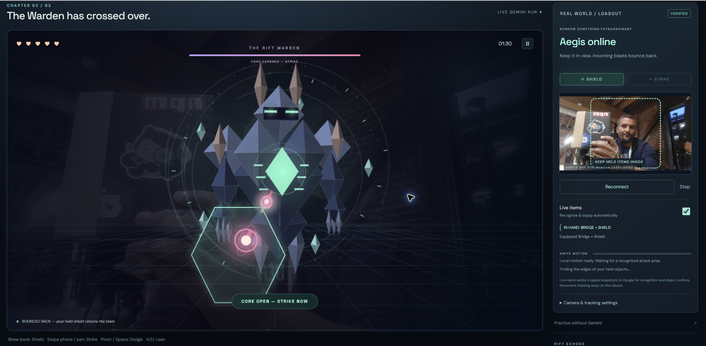
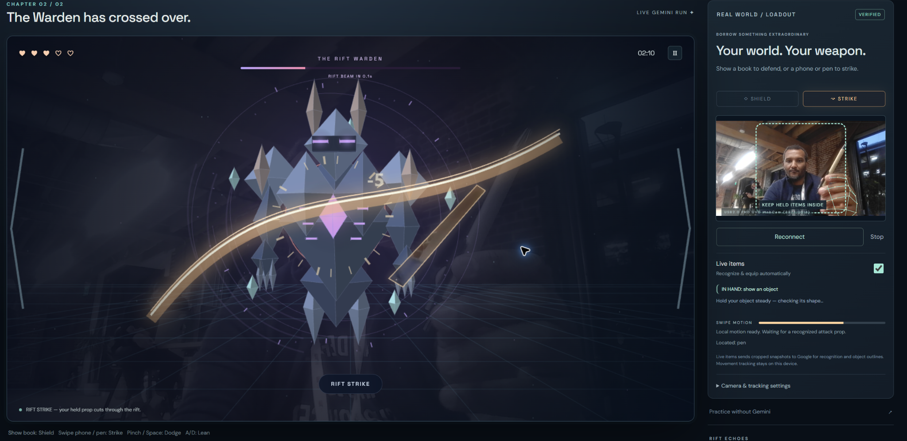
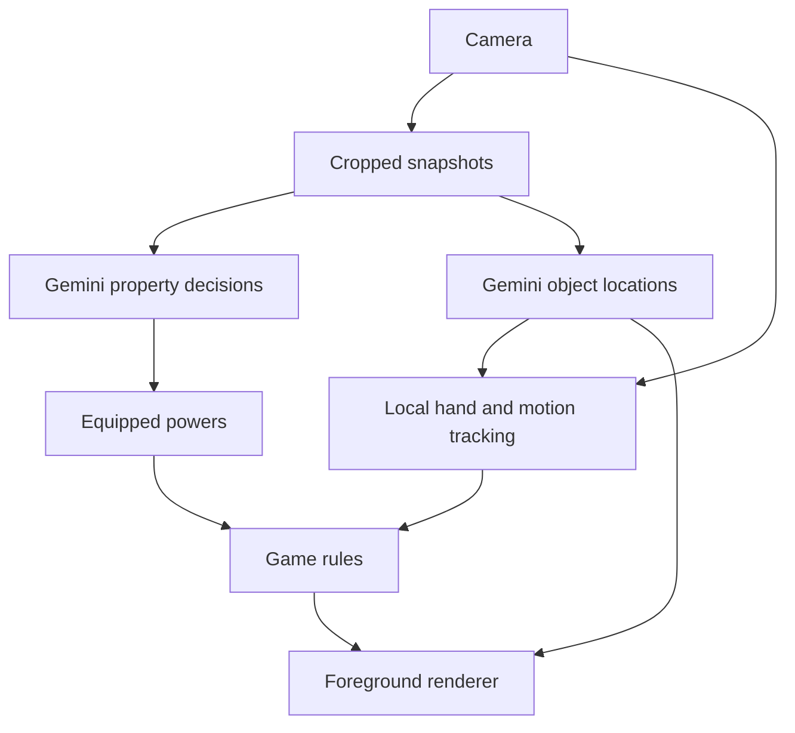

# Rift Walker

**Your world is the inventory.**

A phone becomes a bridge. A book becomes a shield. A pen becomes a blade.

Rift Walker is a hands-on demo that makes learning Google's Decision API and decision APIs in general fun. Clone the repository, try the camera-powered game, and follow how an image becomes a set of answers that your code can act on. Show a phone to build a bridge, a book to raise a shield, or a pen to enable an attack. The demo connects each moment to a simple pattern: define a question, send input, check the response, and apply a rule. Start with no-key practice to explore the game, then configure Gemini to try real API decisions and experiment with the criteria yourself.


**[Visual walkthrough](#visual-walkthrough)** · **[Run locally](#run-locally)** · **[How the AI works](#how-the-ai-works)** · **[Demo talk track](docs/DEMO.md)**

> **About the images:** the opening image and steps 1–3, 5 and 6 are original screenshots supplied from demo runs. Step 4 is a clearly labelled practice-state illustration made with the game drawing code. See [Visual sources](docs/VISUAL-SOURCES.md) for provenance.

## What makes it different

Instead of selecting a predefined item from a menu, present something on your desk and the model evaluates its visible shape and surface. One object can support several abilities; a book and pen can be evaluated together.

- **Borrowed powers:** real-world object properties become game mechanics.
- **Continuous play:** with Live items on, periodic camera checks equip powers automatically, without a capture-and-confirm dialog.
- **Two connected chapters:** a side-scrolling bridge challenge followed by a perspective boss encounter.
- **Physical actions:** hand gestures steer and dodge; local camera motion supports prop swipes even when fingers are obscured.
- **Visible feedback:** separate loadout, motion and object-location indicators explain recognition and tracking.
- **No-key practice:** manually equipped items and keyboard controls let anyone explore the mechanics.

## Visual walkthrough

### 1. Move with your hand - The Broken Reach

The adventure opens on floating islands separated by broken paths. The camera panel sits beside the game so you can see your physical input and the game's response together. Hand landmarks show when the local hand tracker can see your fingers.

**You do:** connect the camera, keep your hand in view, and steer toward the gap. A/D or the arrow keys also move the traveler.  
**The game does:** moves the character through the level and marks the missing path with **WEAVE A WAY FORWARD**.



*Demo frame: the traveler approaches the first gap with 1/5 light recovered. Hand tracking is visible; no held object is equipped in the panel.*

### 2. Jump and explore

Movement and jumping remain responsive while object recognition runs separately. A pinch gesture triggers a jump; the keyboard alternative is Space. Explore the platforms and collect light fragments, then use a borrowed power to span the larger gaps.

**You do:** pinch to jump, or press Space, while steering through the level.  
**The game does:** animates the jump and applies the same platform collision rules for either input method.



*Demo frame: the airborne character and pinching hand are visible together. This still frame illustrates the interaction; it does not measure gesture latency.*

### 3. Show a phone - weave a way forward

Hold a phone, closed notebook, ruler or cardboard inside the camera guide. Gemini evaluates whether a visible held object has the flat or elongated shape needed for **Worldweave**. A qualifying live result equips the ability and weaves a bridge at a nearby unfinished anchor, without a capture-and-confirm dialog.

**You do:** show the object clearly, then move across the new path and continue collecting light.  
**The game does:** creates a solid platform that the character can stand on and cross. Continue through the next gap toward the Warden's gate.


*Demo frame: the run displays **LIVE GEMINI RUN**, a phone in the camera view, and a completed bridge. The live-item panel is checking another frame; recognition updates periodically while the woven bridge remains in the world.*

### 4. Face the Rift Warden - Reality Raid

The second chapter switches to first person. The boss is rendered with perspective geometry over the camera feed when a camera is connected. In live mode, the opening attack cycle waits until the first usable shield, reflection or strike prop has been accepted.

**You do:** show a book or pen, or choose **Boss demo** to jump straight to this encounter.  
**The game does:** telegraphs incoming attacks and exposes its core between attack phases.


The camera-free arena above is the practice-state illustration. With a live feed, the game adds the room behind the boss. Located object regions can be composited back in front of it; this is approximate foreground compositing, not depth sensing or room mapping.

### 5. Raise a book - Aegis

A recognized book, lid or broad object equips **Aegis**. Keep it in view: live-mode shielding does not require an open-palm gesture or a separate guard button. An incoming blast reaches the shield, produces an impact effect, then travels back toward the Warden.

**You do:** wait for SHIELD to light, then hold the object in view.  
**The game does:** blocks the hit and sends the projectile back to damage the boss.



*Demo frame: a book is visible in the camera panel, **Aegis online** and **SHIELD** are active, and the game reports **BOUNCED BACK** while the Warden's core is open.*

When object localization is available, the shield follows the located object's region rather than the wrist. In practice mode, equip Cardboard and hold **K** to guard.

### 6. Sweep a pen - Riftblade

Show a pen, phone or suitable elongated prop and wait for STRIKE to light. Sweep it smoothly left or right. Local motion tracking converts the swipe into an attack, while the boss's current phase determines damage. Hitting an exposed core is more effective than striking its armor.

**You do:** keep a book and pen visible together to combine defense and attack, then strike during CORE OPEN.  
**The game does:** draws the slash, applies damage, and ends the encounter when the boss's health reaches zero.



*Demo frame: **STRIKE** is lit, the locator reports **Located: pen**, and the golden slash deals 5 damage against armor. This is not an exposed-core hit.*

## What can you borrow?

These are example inputs, not guaranteed recognition results. Lighting, framing and visible properties affect the model's decision.

| Power | Visible property | Example objects | Gameplay effect |
| --- | --- | --- | --- |
| **Worldweave** | Flat or elongated shape | Phone, notebook, ruler, cardboard | Builds a bridge near an unfinished anchor |
| **Aegis** | Broad surface | Book, lid, phone, cardboard | Blocks and returns incoming boss attacks |
| **Mirrorwake** | Visible shine or reflection | Spoon, foil, mirror | Also enables defensive reflection in the boss encounter |
| **Riftblade** | Suitable handheld elongated or rectangular prop | Pen, phone, spoon, ruler | Enables a swipe attack |

The Decision API evaluates these properties independently. An object can qualify for more than one power. Merely naming an object does not grant an ability.

## How the AI works

In this demo, a decision API answers specific questions about an input, such as whether a held object has a broad surface. The application checks the returned values before granting a power. This is a useful pattern to explore beyond games: model answers inform a decision, while your code defines what happens next.

The application separates **eligibility**, **location**, **movement**, and **game rules**.

| Component | Responsibility | What it does not decide |
| --- | --- | --- |
| **Gemini Decision API** | Evaluates visibility and four object properties; accepted results equip powers | Movement or collision timing |
| **Gemini vision localization** | Returns up to two held-object boxes and approximate outlines | Whether a power is allowed |
| **Local block matching** | Follows image features between model responses and detects swipes | The identity or meaning of an object |
| **MediaPipe hand tracking** | Supplies steering, pinch, lean and hand gestures | Object eligibility |
| **Game engine** | Builds platforms, checks cooldowns, resolves blocks and applies damage | It does not invent successful model responses |



Recognition and localization are periodic cloud checks, not per-frame inference. Each loop allows one request at a time and waits 1.2 seconds after a response. Local tracking runs between responses. Enabling object outlines adds a separate image request to the recognition loop.

Recent accepted powers expire after 4.5 seconds without confirmation. One ambiguous observation can receive a bounded one-second grace period; repeated uncertainty cannot preserve a power indefinitely. Clear rejection removes it.

## Run locally

**Requirements:** Node.js 20+, a desktop browser, and a webcam for physical input. Live recognition also needs a Gemini key with access to the configured models. No npm packages are required to run the server or game.

```powershell
git clone https://github.com/Yoha02/RiftWalker.git
cd RiftWalker
Copy-Item .env.example .env
# Set GEMINI_API_KEY in your private .env file for live recognition.
npm start
```

On Windows, you can also double-click **START-RIFT-WALKER.cmd**. Keep the terminal open and use the **exact URL printed by the server**: it selects another port if 4173 is occupied. Allow camera access, choose your external camera under **Camera & tracking settings**, and leave **Live items** enabled.

The example configuration uses `gemini-4-hydrogen` for vision and `gemini-decision-1` for decisions. Model access, quota and billing depend on your account. `VALIDATE-GEMINI.cmd` checks the saved configuration with a real API request without displaying the key.

### Learn by following one decision

1. **Try the game:** start with the no-key practice mode below to see how bridges, shields and strikes work. Practice uses manual inputs, so it does not call the Decision API.
2. **Read the questions:** open [`lib/decision.mjs`](lib/decision.mjs). `CRITERIA` defines the object properties, and `decisionRequest` combines an image with explicit questions.
3. **Follow the request:** find `/api/scan` in [`server.mjs`](server.mjs) to see how the server sends the request while keeping the API key out of browser code.
4. **Check the answer:** return to `normalizeDecisions` in `lib/decision.mjs` to see how response validation and thresholds determine which powers qualify. Read [`tests/decision.test.mjs`](tests/decision.test.mjs) for accepted, rejected and malformed examples.
5. **Experiment:** configure Gemini, show an object, then change one criterion or threshold and compare the outcome. Run `npm test` after editing; changing the intended acceptance rules may also require updating the tests.

### Try it without a key

Open **PLAY-RIFT-WALKER.html** in Chrome or Edge, or start the local server without a key. Expand **Practice without Gemini** and equip sample items. This exercises gameplay with manually selected powers and labels the run **Practice**. It does not perform AI object recognition. Optional hand tracking needs internet access to download its model assets.

| Action | Keyboard | Camera input |
| --- | --- | --- |
| Move / lean | A/D or arrow keys | Move your tracked hand left or right |
| Jump / dodge | Space | Pinch thumb and index finger |
| Weave | E with a borrowed bridge power | Automatic near a gap after live acceptance |
| Strike | J | Swipe with an equipped strike prop |
| Guard | Hold K with an equipped defense power | Automatic while a live shield or reflect power is equipped |
| Pause | Esc | Pause button |

For a short presentation, connect the camera, select **Boss demo**, and enable **Showcase**. See the [two-minute demo script](docs/DEMO.md).

## Project map

| Files | Purpose |
| --- | --- |
| [`public/core.mjs`](public/core.mjs) | Traversal, bridges, progression and shared game state |
| [`public/raid.mjs`](public/raid.mjs), [`public/raid-view.mjs`](public/raid-view.mjs) | Boss simulation and perspective rendering |
| [`public/game.mjs`](public/game.mjs) | UI, camera input and recognition orchestration |
| [`public/object-motion.mjs`](public/object-motion.mjs), [`public/object-tracking.mjs`](public/object-tracking.mjs) | Local prop motion and coordinate mapping |
| [`lib/decision.mjs`](lib/decision.mjs), [`lib/objects.mjs`](lib/objects.mjs) | Model requests and response validation |
| [`server.mjs`](server.mjs) | Local static server and server-side Gemini requests |
| [`tests/`](tests/) | Game rules, camera lifecycle, model contracts and motion checks |
| [`docs/`](docs/) | Demo guide and public walkthrough assets |

## Validation and current limits

```powershell
npm test
node build-standalone.mjs
```

The current suite has **49 automated tests** covering traversal, camera lifecycle, model-response validation, request scheduling, shields, strikes, simultaneous equipment, bounded grace periods, synthetic prop movement, coordinate mapping and foreground drawing order. Browser checks confirmed the updated interface and keyboard strike damage.

This is a **local hackathon prototype**. Cloud inference can lag, thin pens can be difficult to track, and approximate object outlines can include background pixels. Two-object localization and physical pen/book alignment still need a systematic hands-on validation pass. The supplied screenshots show moments from a demo; they do not establish recognition reliability or latency. Synthetic motion tests and practice-state illustrations do not establish real-camera accuracy.

## Privacy

Camera preview, hand inference and movement tracking stay on the device. With **Live items** on, cropped snapshots pass through the local server to Google for recognition; **Object outlines** adds localization requests. Both loops stop when play is paused, hidden, in a dialog, disconnected or finished. Switch Live items off to stop both.

The API key stays in the local server's `.env` file. Camera images are not saved by the server. Run logs contain decisions and gameplay events, not images or credentials. Private keys, logs and runtime camera artifacts are excluded from Git. The user-supplied screenshots explicitly selected for this README are public documentation assets and include their visible camera previews.

Built with vanilla JavaScript, Canvas 2D, Node.js, MediaPipe and Gemini. The faceted scene and boss visuals are procedurally drawn by the game.
