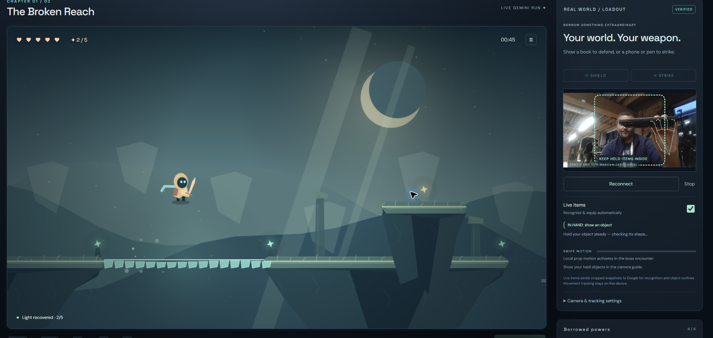
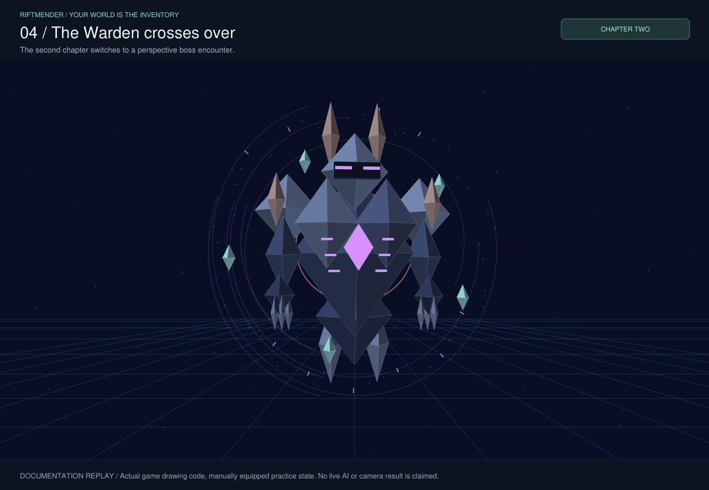

# Rift Walker

**Your world is the inventory.**

Rift Walker is a small camera-powered game for learning Google's Decision API and decision APIs in general. Show a phone to build a bridge, a book to raise a shield, or a pen to enable an attack. Follow how an image becomes a set of answers, then how the game checks those answers before granting a power.

Clone the repository and start with practice mode. When you're ready, connect Gemini and experiment with the questions and rules yourself.

[Run locally](#run-locally) · [Visual walkthrough](#visual-walkthrough) · [How the AI works](#how-the-ai-works) · [Explore the code](#explore-the-code)



## Run locally

You need **Git**, **Node.js 20 or later**, and a desktop browser such as Chrome or Edge. A camera is optional for practice mode and required for live object recognition. No npm packages need to be installed.

### 1. Clone and start

```sh
git clone https://github.com/Yoha02/RiftWalker.git
cd RiftWalker
npm start
```

Open the URL printed in the terminal. The server starts at `http://127.0.0.1:4173` and chooses another port if that one is busy. Keep the terminal open while playing; press **Ctrl+C** to stop it.

On Windows, you can also start the server by double-clicking `START-RIFT-WALKER.cmd`.

### 2. Try practice mode

Expand **Practice without Gemini** and equip a sample item. Use the keyboard controls below to move, build bridges and fight the boss. Practice mode uses manually selected powers and makes no object-recognition API calls.

For a quick look without starting the server, open `PLAY-RIFT-WALKER.html` in Chrome or Edge. This standalone edition supports practice mode only. Optional hand tracking downloads its model assets over the internet.

### 3. Enable live recognition

You need a Gemini API key with access to the configured models and available quota.

Copy the configuration template into a private `.env` file:

**Windows PowerShell**

```powershell
Copy-Item .env.example .env
```

**macOS or Linux**

```sh
cp .env.example .env
```

Open `.env` in a text editor and set `GEMINI_API_KEY` to your key. The template selects `gemini-decision-1` for decisions and `gemini-4-hydrogen` for vision. Model access depends on your account.

Restart `npm start`, open the printed URL, allow camera access, and enable **Live items**. Choose your camera under **Camera & tracking settings** if needed. Hold an object inside the camera guide and wait for its power indicator to light.

To check your key and model access separately, run `node validate-gemini.mjs`. This sends real API requests without displaying the key. Keep `.env` private; it is excluded from Git.

### Controls

| Action | Keyboard | Camera input |
| --- | --- | --- |
| Move / lean | A/D or arrow keys | Move your tracked hand left or right |
| Jump / dodge | Space | Pinch thumb and index finger |
| Weave a bridge | E with a bridge power equipped | Automatic near a gap after live acceptance |
| Strike | J with a strike power equipped | Swipe with an equipped strike prop |
| Guard | Hold K with a defense power equipped | Automatic while a live shield or reflect power is equipped |
| Pause | Esc | Pause button |

Select **Boss demo** to jump straight to the boss encounter.

### If something isn't working

- **The page won't open:** keep the server running and use its printed URL, including the port number.
- **The camera isn't available:** allow camera access in your browser and check the selected device under **Camera & tracking settings**.
- **Live recognition isn't available:** run the server edition, check `.env`, restart the server, and run `node validate-gemini.mjs` to check access and quota. Practice mode works without a key.
- **An object isn't recognized:** hold it steady inside the guide with its shape clearly visible. Recognition happens periodically, so wait for the power indicator before using it.

## Visual walkthrough

### 1. Move with your hand

Connect the camera and move your hand left or right to steer through The Broken Reach. A/D or the arrow keys also work. Approach the gap marked **WEAVE A WAY FORWARD**.


### 2. Jump and explore

Pinch your thumb and index finger, or press Space, to jump. Collect light fragments as you explore the platforms.


### 3. Show a phone to build a bridge

Hold a phone, closed notebook, ruler or cardboard inside the camera guide. When the Decision API accepts its flat or elongated shape, **Worldweave** builds a bridge at a nearby unfinished crossing. Walk across to continue.


### 4. Face the Rift Warden

The second chapter puts the boss over your camera feed. Show a book or pen to prepare for the encounter. Watch the attack warnings and strike when the core opens.



*Practice illustration without a camera feed. Live mode uses your camera view as the backdrop.*

### 5. Raise a book to guard

A recognized book or broad object equips **Aegis**. Wait for **SHIELD** to light, then keep the object in view to block and return incoming blasts. In practice mode, equip Cardboard and hold K.


### 6. Sweep a pen to strike

Show a pen, phone or suitable elongated prop and wait for **STRIKE** to light. Swipe smoothly left or right to attack. An exposed core takes more damage than armor. Keep a book and pen visible together to combine defense and attack.


## How the AI works

A decision API answers specific questions about an input. Here, the input is a camera snapshot and the questions concern the held object's visible properties. The game validates the response and checks probability and confidence thresholds before equipping a power.

| Power | Property checked | Example objects | Effect |
| --- | --- | --- | --- |
| **Worldweave** | Flat or elongated shape | Phone, notebook, ruler | Builds a bridge |
| **Aegis** | Broad surface | Book, lid, cardboard | Blocks and returns attacks |
| **Mirrorwake** | Visible shine or reflection | Spoon, foil, mirror | Enables defensive reflection |
| **Riftblade** | Suitable elongated or rectangular shape | Pen, phone, ruler | Enables swipe attacks |

Each property is evaluated independently, so one object can qualify for several powers. Lighting, framing and visible shape affect the result.

The Decision API determines which powers qualify. A separate Gemini vision request can locate held objects. Local hand and image-motion tracking handle movement between cloud responses, while game code controls collisions, cooldowns and damage.

Recognition runs periodically, not on every frame. Powers expire without fresh confirmation. Turning off **Live items** stops recognition and object-localization requests.

## Explore the code

Follow one decision from input to gameplay:

1. Read `CRITERIA` in [`lib/decision.mjs`](lib/decision.mjs) to see the questions about each object property.
2. Follow `decisionRequest` in that file to see how the image and questions become a request.
3. Find `/api/scan` in [`server.mjs`](server.mjs) to see the server call the API with a private key.
4. Read `normalizeDecisions` to see how invalid answers are rejected and thresholds determine accepted powers. [`tests/decision.test.mjs`](tests/decision.test.mjs) includes accepted, rejected and malformed examples.
5. Follow the result into [`public/game.mjs`](public/game.mjs), which updates the equipped powers. Change one criterion or threshold and compare the outcome.

Other useful files:

| File | Purpose |
| --- | --- |
| [`public/core.mjs`](public/core.mjs) | Movement, bridges and level progression |
| [`public/raid.mjs`](public/raid.mjs) | Boss combat rules |
| [`public/raid-view.mjs`](public/raid-view.mjs) | Boss rendering |
| [`public/object-motion.mjs`](public/object-motion.mjs) | Local prop movement and swipe detection |
| [`lib/objects.mjs`](lib/objects.mjs) | Object-localization requests and response validation |

Run the tests after making changes. If you change an acceptance rule, update the tests to reflect the intended behavior. Rebuild the standalone edition after changing the game files:

```sh
npm test
node build-standalone.mjs
```

## Limitations and privacy

Cloud responses can lag, thin pens can be difficult to track, and object outlines can include background pixels. Two-object tracking still needs more hands-on testing. The boss is composited over the camera view; this does not map your room or measure depth.

Camera preview, hand tracking and movement tracking run locally. With **Live items** enabled, cropped snapshots are sent through the local server to Google for recognition. **Object outlines** adds localization requests. The server does not save camera images, and the API key stays on the server in `.env`.
