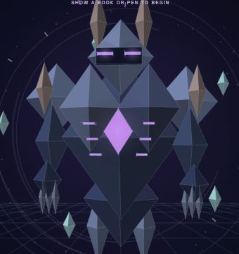

# Walkthrough visual sources

## Original demo screenshots

The README hero and steps 1–3 use original screenshots supplied by the project owner for the public walkthrough. Each PNG is copied byte-for-byte from the supplied file, with only its filename changed. No gameplay state, camera content, or status text has been retouched.

| Asset | Visible demo state |
| --- | --- |
| `demo-01-hand-controls.png` | Traveler beside the first gap; open hand and tracking landmarks in the camera panel; 1/5 light |
| `demo-02-jump.png` | Traveler airborne; pinching hand visible in the camera panel |
| `demo-03-phone-bridge.png` | Phone held horizontally; completed bridge; LIVE GEMINI RUN; 2/5 light |

The screenshots document visible moments, not measured recognition accuracy or input latency. The bridge frame shows a completed path while the live-item panel is checking another snapshot. The original book-shield and pen-strike screenshots have not yet been added to the repository.

## Renderer illustrations

README steps 4–6 use **documentation replays of actual game drawing code**, with deterministic, manually equipped practice states. They are not screenshots of successful live model decisions and contain no camera feed, people or API responses. The earlier traversal illustrations remain available as supplementary assets but are no longer used in the README.

`scripts/render-walkthrough.mjs` calls the existing game logic to build a bridge, enter the boss encounter, reflect a projectile and perform a strike. It invokes the current rendering functions through a small Canvas-to-SVG adapter. The framing, titles and captions are documentation annotations, not the application's interface. The resulting SVGs preserve the scene geometry; their PNG versions omit alpha-gradient glow/vignette layers and flatten the sky gradient for compatibility with the rasterizer. Canvas shadows are not reproduced.

| Asset | Depicted state |
| --- | --- |
| `01-broken-reach` | Traveler beside an unbuilt gap |
| `02-worldweave` | Same gap after a practice bridge power builds a platform |
| `03-cross-the-rift` | Traveler moving across the built bridge |
| `04-reality-raid` | Perspective boss during windup, without a camera backdrop |
| `05-aegis` | Practice shield reflects an incoming orb |
| `06-riftblade` | Practice strike against an exposed core |

The following image **is a saved browser capture** from the updated game. It is a crop of the Warden, without a camera feed. It establishes the appearance of that rendered scene, not recognition accuracy:



## Reproduce the illustrated frames

From the repository root:

```powershell
node scripts/render-walkthrough.mjs
python -m pip install pymupdf
python scripts/rasterize-walkthrough.py
```

Python/PyMuPDF is an optional documentation dependency. It is not required to run the game. The scripts make no API calls and do not access a camera or API key.
